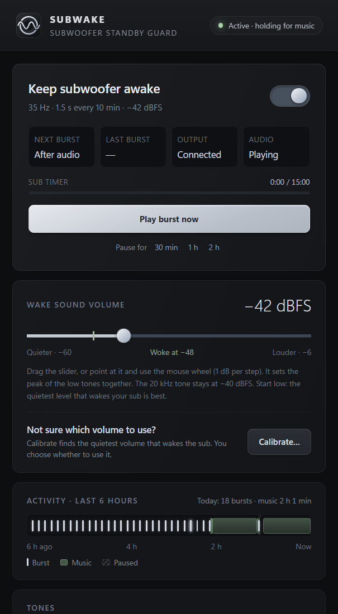
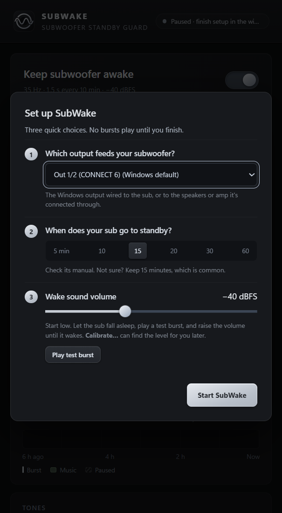
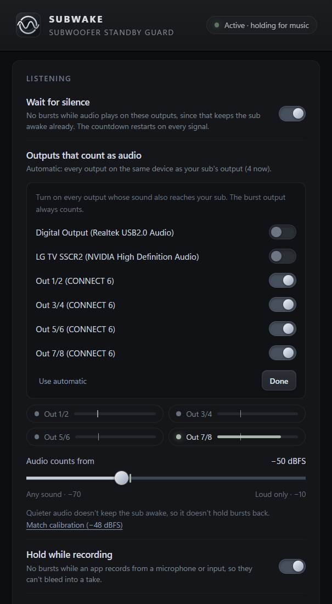
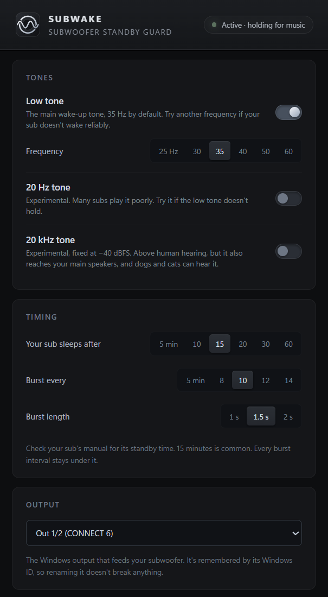
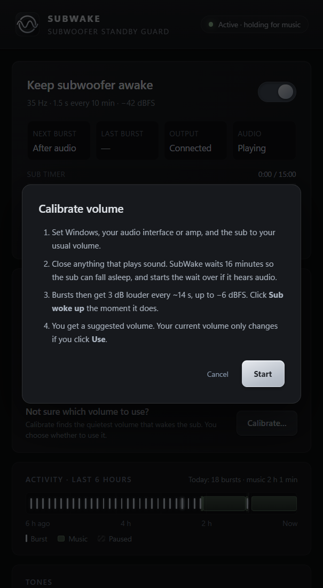

<p align="center">
  
</p>

<h1 align="center">SubWake</h1>

<p align="center">
  <b>Keeps your subwoofer out of auto-standby, without you hearing it.</b><br>
  A small, free Windows tray app for subwoofers that switch off after a few minutes of quiet.
</p>

<p align="center">
  <a href="https://github.com/Rumenito/SubWake/releases/latest"><b>Download for Windows</b></a> ·
  <a href="#install">Install</a> ·
  <a href="#how-it-works">How it works</a> ·
  <a href="#faq">FAQ</a> ·
  <a href="PRIVACY.md">Privacy</a>
</p>

<p align="center">
  
</p>

---

## Why

Many powered subwoofers have an **auto-standby** feature: after some minutes without an input signal (often 15), they switch off to save power. When sound comes back, they take a second or two to wake up. You lose the first notes of a song, the start of a video, or the bass of a game sound, and some subs pop or thump as they switch on.

On many subs this can't be turned off. See [Compatible subwoofers](#compatible-subwoofers) for some of them.

**SubWake fixes it.** Every few minutes it plays a short, quiet low-frequency tone through the output that feeds your sub. That's enough to reset the sub's standby timer, and quiet enough that you don't notice it. While music or any other audio is playing, it stays silent, because your audio already keeps the sub awake.

## Features

- **Wait for silence.** No bursts while audio plays on the outputs that reach your sub. The next burst comes one interval after the audio stops. SubWake's own bursts never count.
- **Your volume, your choice.** You set the wake sound with a slider. **Calibrate…** finds the quietest level that wakes your sub, and only suggests it.
- **Fits your sub.** Set when your sub goes to standby (5 to 60 minutes), the tone's frequency (25 to 60 Hz), how often it plays and for how long.
- **Stays out of your way.**
  - Holds while any app records from a microphone or input.
  - Holds while chosen apps are open, for example a DAW that plays through ASIO.
  - Lets the sub sleep when you've been away from the PC for a while, and wakes it at your first touch.
  - Optional quiet hours, and an optional pause while the PC is locked.
- **See what happens.** A sub timer shows how long since the sub last got a signal, and an activity timeline shows bursts, music and pauses over the last 6 hours.
- **Runs quietly in the tray.** It starts at sign-in, uses almost no resources, and keeps working if the output disappears for a while.
- **Update check.** Once a day it asks GitHub whether there's a newer version. You can turn this off, and nothing installs by itself.
- **Free and open source** (MIT license), with no ads, accounts or telemetry.

| First-run setup | Choosing which outputs count as audio | Tones and timing | Calibration |
|---|---|---|---|
|  |  |  |  |

## Install

1. **Download** `SubWake-Setup-<version>-x64.exe` from the [latest release](https://github.com/Rumenito/SubWake/releases/latest).
2. **Run it.** It installs for your Windows user only and needs no admin rights.
   - If Windows shows **"Windows protected your PC"**, click **More info**, then **Run anyway**. This happens because the installer isn't code-signed yet (see [Code signing policy](#code-signing-policy)). You can check the download against the `SHA256` checksum listed in the release.
3. **Read the short privacy note** and choose your options: start at sign-in (on by default), check for updates (on by default), desktop shortcut (off).
4. **SubWake opens with a three-step setup:**
   1. Pick the Windows output that feeds your subwoofer. Your Windows default output is suggested.
   2. Pick when your sub goes to standby. Check its manual; if you're not sure, keep 15 minutes.
   3. Set the wake volume. Start low, let the sub fall asleep, click **Play test burst**, and raise the volume until the sub wakes.
5. Click **Start SubWake**. From now on it runs in the tray.

**Requirements:** Windows 10 22H2 or Windows 11, 64-bit (x64). The window uses Microsoft WebView2, which Windows 11 already includes. Without it, SubWake still runs from the tray.

## How it works

- **The burst:** a sine tone (35 Hz by default) with soft fades, 1 to 2 seconds long, played on every channel of the chosen output. Low tones share the volume as one combined peak, so the burst never clips.
- **The schedule:** the next burst is due one interval after the last one, and every interval choice stays under your sub's standby time. Timing uses the system tick counter, so clock changes never make it late.
- **Wait for silence:** SubWake reads Windows' peak meters on the watched outputs 20 times a second. Audio at or above **Audio counts from** (−50 dBFS by default) restarts the countdown. By default it watches every output on the same device as the burst output (for "Speakers (Realtek Audio)", every "(Realtek Audio)" output). **Choose outputs…** lets you pick them yourself.
- **Pauses**, in priority order: setup not finished, snoozed, PC locked (optional), quiet hours (optional), you're away, an app is recording, a hold app is open.
- **Calibration:** SubWake waits until your sub has fallen asleep (its standby time plus one minute), then plays bursts 3 dB louder every ~14 seconds until you click **Sub woke up**. It suggests that level plus a 6 dB safety margin, and only uses it if you click **Use**.

Every control and rule is described in [Docs/FEATURES.md](Docs/FEATURES.md).

## Tips

- **Find the right volume.** The sound that reaches the sub also depends on the Windows volume for that output, your interface or amp, and the sub's own gain. Calibrate at your usual settings.
- **Music played but the sub fell asleep anyway?** The music may have been loud enough to count, but too quiet to keep the sub awake. Run Calibrate…, then click **Match calibration** under **Audio counts from**.
- **Using a DAW with ASIO?** ASIO audio bypasses Windows, so SubWake can't see it. Add the DAW to **Hold while these apps are open**.
- **Speakers or headphones on the same device?** If music on your headphones doesn't reach the sub, use **Choose outputs…** to turn the headphones off, so their audio doesn't hold the bursts.

## Compatible subwoofers

SubWake works with any subwoofer that wakes from an audio signal on its input. It isn't needed for subs that are switched on by a 12 V trigger or by your amplifier.

| Subwoofer | Standby after | Works with | Notes |
|---|---|---|---|
| ADAM Audio T10S | 15 min | 35 Hz | Auto-standby can't be turned off. |
| PreSonus Temblor T8 | Check manual | Any | Auto-standby can't be turned off without opening the sub. |
| M-Audio BX10s | 15 min | Any | No off switch for auto-standby. |
| ADAM Audio Sub8 / Sub10 / Sub12 | 15 min | Any | Auto-standby can also be turned off on the sub. |
| Edifier T5 / T5s | 15 min | Any | Has an auto-standby switch. |
| JBL LSR310S | Check manual | Any | Auto-standby can also be turned off (see its manual). |
| Kali Audio WS-12 | 20 min (V2: about 30) | Any | Auto-standby can also be turned off with DIP switch 9. |
| KRK S8.4 / S10.4 / S12.4 | 30 min | Any | Auto-standby can also be turned off with the standby switch. |
| Logitech Z906 | 20 min | Any | Auto-standby can also be turned off with the standby button. |
| Mackie MR10S mk3 | 13 min | Any | Auto-standby can also be turned off (On / Off / Auto switch). |
| Teufel subwoofers | About 20 min | Any | Auto-standby can also be turned off (AUTO / ON switch). |
| Yamaha NS-SW / YST-SW home subwoofers | 7 to 8 min | Any | Auto-standby can also be turned off (AUTO STANDBY switch). |

Has SubWake kept your sub awake? [Add it to this list](https://github.com/Rumenito/SubWake/issues/new?template=subwoofer-report.yml) with its standby time and the tone and volume that worked.

## FAQ

**My subwoofer keeps turning off, or goes to sleep after 15 minutes. Will this fix it?**
If your sub switches to standby when it gets no signal for a while, and wakes again when sound comes back, yes. SubWake sends it a short, quiet tone before the timer runs out, so it never falls asleep while your PC is on. If your sub's auto-standby can be turned off, try that first.

**Will I hear it?**
At a calibrated level, usually not: it's a short, quiet, very low tone. Turn the volume down until you don't notice it but the sub still wakes. The optional 20 kHz tone is above human hearing, but dogs and cats can hear it, so it's off by default.

**Can it damage my speakers?**
The burst is a short, faded sine tone that never clips, at a level you choose (−60 to −6 dBFS). Start low and only raise it as far as your sub needs. Like any audio, it's played at your own risk (see the [license](LICENSE)).

**Does it use the internet?**
Only for the optional daily update check, which asks GitHub for the latest version. See [PRIVACY.md](PRIVACY.md).

**Where are my settings?**
In `%LOCALAPPDATA%\SubWake`: `settings.json` and `subwake.log`. The window's **Open log** link opens the log.

**Does it run on macOS or Linux?**
No. It uses Windows' audio system directly.

More fixes are in [Docs/TROUBLESHOOTING.md](Docs/TROUBLESHOOTING.md).

## Uninstall

**Settings → Apps → Installed apps → SubWake → Uninstall.** Your settings and log stay in `%LOCALAPPDATA%\SubWake`. Delete that folder to remove them too.

## Building from source

You need the .NET 10 SDK and Inno Setup 6, either installed system-wide or in the project's `Toolchains\` folder. Then run:

```
powershell -ExecutionPolicy Bypass -File Tools\Build.ps1
```

The script runs the build-time tests, publishes a self-contained app and builds the installer in `Builds\`. Releases are built the same way by [GitHub Actions](.github/workflows/build.yml). Details are in [Docs/WORKFLOW.md](Docs/WORKFLOW.md), and the code layout is in [Docs/ARCHITECTURE.md](Docs/ARCHITECTURE.md).

Bug reports and ideas are welcome in [Issues](https://github.com/Rumenito/SubWake/issues). See [CONTRIBUTING.md](CONTRIBUTING.md).

## Code signing policy

Releases are built from this repository's source by GitHub Actions. Every release is reviewed and approved by the maintainer before it's published.

The installers aren't code-signed yet. Free code signing for open-source projects from the [SignPath Foundation](https://signpath.org) is being applied for. Once it's approved, this section will carry their attribution, and every release will be signed.

- **Committers and reviewers:** [Rumenito](https://github.com/Rumenito)
- **Approvers:** [Rumenito](https://github.com/Rumenito)

**Privacy:** this program will not transfer any information to other networked systems unless specifically requested by the user or the person installing or operating it. The only network request is the optional update check, which you can turn off during installation and in the app. See [PRIVACY.md](PRIVACY.md).

## License

[MIT](LICENSE) © 2026 Rumenito.
